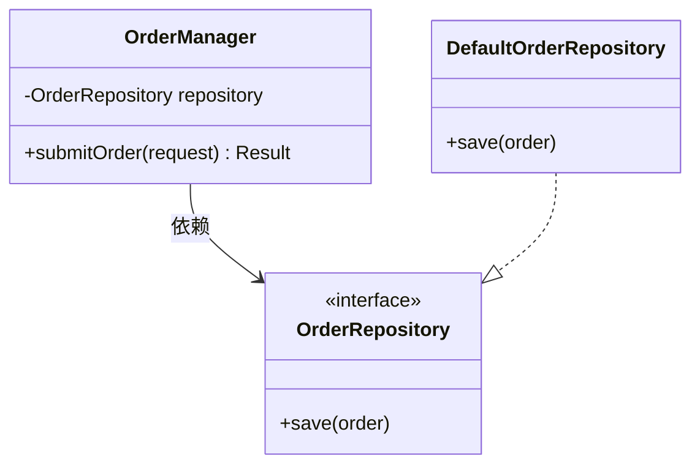
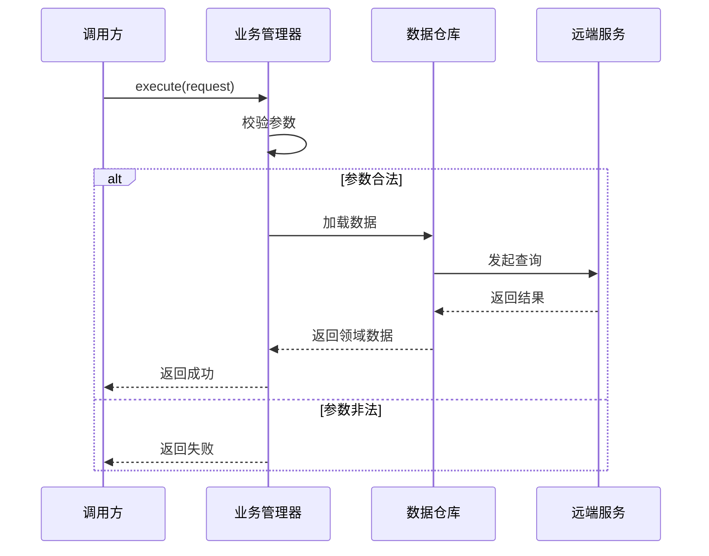
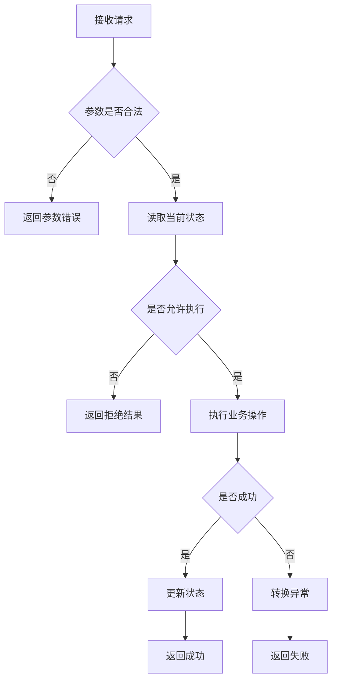
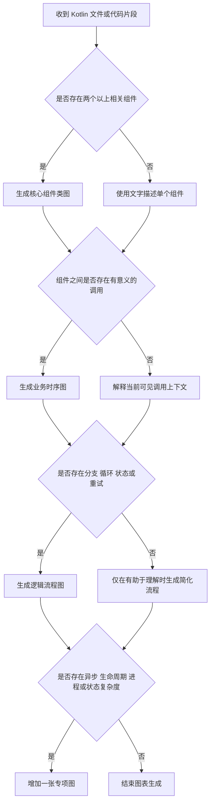

------

## name: analyzing-kotlin-code description: Use when analyzing specified Kotlin files or code snippets in Android, Android Framework, JVM, or mixed Kotlin-Java projects, especially when the reader needs to understand business logic while learning Kotlin language features and Java interoperability.

# Kotlin 代码分析与学习

## 概述

本 Skill 用于分析用户指定的 Kotlin 文件或代码片段，主要面向具有 Java、C++ 和 Android Framework 开发经验，但正在学习和维护 Kotlin 项目的工程师。

分析必须同时帮助用户完成两个目标：

1. 理解代码涉及的业务职责、核心组件、执行流程、状态变化和潜在风险。
2. 学习维护这段代码所需的 Kotlin 语法、语言特性、惯用写法和 Java 互操作知识。

不要输出脱离实际代码的通用 Kotlin 教程。所有 Kotlin 知识都应尽量结合当前代码进行讲解。

## 适用场景

在以下场景中使用本 Skill：

- 用户要求分析指定的 Kotlin 文件。
- 用户要求分析一段 Kotlin 代码。
- 用户需要理解 Kotlin 代码中的业务逻辑。
- 用户需要分析 Kotlin 与 Java 混合调用代码。
- 用户不熟悉代码中使用的 Kotlin 语法或特性。
- 用户要求生成详细的 Kotlin 代码分析报告。
- 用户需要通过类图、时序图、逻辑流程图理解代码。
- 用户准备维护或修改一个不熟悉的 Kotlin 模块。
- 用户需要从 Android Framework 角度分析 Kotlin 代码。
- 用户需要了解 Kotlin 代码在 JVM 层面如何暴露给 Java。

以下场景不应将本 Skill 作为主要工作流：

- 用户未指定入口文件，却要求直接完整分析整个大型仓库。
- 用户仅要求将 Java 代码机械转换为 Kotlin。
- 用户尚未明确功能需求，却要求直接实现新功能。
- 用户只需要格式化、静态检查或代码排版。
- 用户希望学习完全独立于具体代码的 Kotlin 基础教程。

## 核心原则

### 业务理解优先

首先说明代码实现了什么业务、承担什么职责、可能位于系统的什么位置，然后再解释 Kotlin 如何实现这些逻辑。

不要一开始就逐行翻译语法。

### 区分事实与推断

重要结论必须使用以下置信度标记之一：

- **代码可确认**：可以直接从当前代码中确认。
- **合理推断**：根据代码可以较可靠地推断，但缺少完整上下文。
- **需要更多上下文**：必须结合调用方、实现类、配置、Manifest、依赖注入、生成代码或其他文件才能确认。

不得把推断内容写成确定事实。

### Kotlin 知识必须源于当前代码

只讲解以下 Kotlin 知识：

- 当前代码中实际出现的语言特性。
- 会影响当前代码行为的语言特性。
- 修改当前代码前必须理解的语言特性。
- 理解 Kotlin 与 Java 交互所必需的知识。

不要罗列与当前代码无关的 Kotlin 特性。

### 按执行路径解释，而不是按文件顺序复述

优先按照代码实际运行顺序解释核心逻辑：

```text
入口
  → 参数校验
  → 状态查询
  → 业务判断
  → 调用依赖组件
  → 更新状态
  → 回调或返回结果
```

不要只是从文件第一行开始依次解释到最后一行。

### 尊重现有项目约束

不要仅仅因为另一种写法更符合 Kotlin 惯用风格，就建议重写现有代码。

对于 Android Framework、系统平台、厂商代码或成熟的 Java/Kotlin 混合项目，需要考虑：

- API 兼容性。
- ABI 和二进制兼容性。
- Java 调用方。
- Kotlin 编译后生成的 JVM 字节码和接口。
- 应用或系统启动性能。
- 内存和对象分配。
- 线程模型。
- Binder 调用行为。
- 当前项目的代码风格。
- 构建系统限制。
- Kotlin 版本限制。
- 长期维护成本。

## 必须执行的分析流程

必须按照以下顺序进行分析。

### 1. 确定分析边界

首先识别：

- 用户提供的文件或代码片段。
- 当前可见的包名和 import。
- 当前代码中定义的类、接口、对象、函数和属性。
- 被引用但未提供源码的外部类型。
- 可能的业务入口。
- 会显著影响结论但当前缺失的上下文。

不得默认未提供的外部类型一定具有某种实现行为。

### 2. 建立业务整体认知

总结以下信息：

- 每个文件的大致职责。
- 当前代码实现的核心业务能力。
- 输入是什么。
- 输出是什么。
- 维护了哪些重要状态。
- 依赖哪些外部组件。
- 可能的调用方和被调用方。
- 成功路径。
- 失败路径。
- 异常路径。
- 取消和资源清理路径。

### 3. 识别核心组件

只选择真正参与当前核心业务路径的组件。

核心组件可以包括：

- 类或接口。
- Kotlin `object`。
- Repository、Manager、Controller、Service、UseCase、DataSource 或 ViewModel。
- Android 组件。
- Binder 接口、Stub 或 Proxy。
- Callback 或 Listener。
- 协程作用域或 Flow 生产者。
- 重要领域模型。
- Kotlin 与 Java 边界上的关键类型。

不要把所有工具类和普通数据类都放入主图中。

### 4. 生成业务图表

除非代码片段过小、无法形成有意义的关系，否则图表为必选输出。

默认使用 Mermaid 语法。

每张图后必须附带文字说明，确保即使用户当前环境无法渲染 Mermaid，也能够理解图中的主要含义。

优先根据代码中可确认的信息生成图表。对于推断出的节点或连线，必须明确标记。

#### 4.1 核心组件类图

当代码中存在两个或两个以上有关联的类型时，生成类图。

类图应尽量展示：

- 重要类和接口。
- 类的继承关系。
- 接口实现关系。
- 组合、聚合或核心依赖关系。
- 核心属性。
- 重要公共方法或业务方法。
- `object`、`data class`、`sealed class` 等 Kotlin 类型特征。
- 扩展函数所属关系。
- Kotlin 与 Java 的边界。

参考格式：



类图约束：

- 主类图建议控制在 3 至 12 个核心组件。
- 不展示无关的 getter、setter 和普通工具方法。
- 图过于复杂时，应按业务领域拆分。
- 推断出的类型可使用 `<<推断>>` 或 `<<inferred>>` 标记。
- 推断出的关系应使用虚线或明确标注“推断”。
- 不得虚构继承、生命周期或对象持有关系。

#### 4.2 核心业务时序图

至少为最重要的一条执行路径生成一张时序图。

时序图应展示：

- 调用入口或触发方。
- 核心业务组件。
- 同步调用。
- 异步调用。
- 回调。
- 协程调用。
- Flow 数据传递。
- Binder 跨进程调用。
- 主要条件分支。
- 失败或替代路径。
- 线程边界。
- 进程边界。

参考格式：



分析 Android Framework 代码时，应在图中标记以下边界：

```text
应用进程
system_server
Binder 线程
主线程
Handler 线程
协程调度器
Native 进程
```

除非代码中能够确认，否则不得擅自断定发生了线程切换。

无法确认的线程或进程边界必须标记为推断。

#### 4.3 业务逻辑流程图

当代码中存在明显的条件分支、循环、重试、参数校验、状态机或状态更新时，生成逻辑流程图。

流程图应展示：

- 入口条件。
- 参数校验。
- 决策节点。
- 状态读取。
- 状态写入。
- 异常处理。
- 重试。
- 降级逻辑。
- 最终结果。

参考格式：



#### 4.4 可选图表

只有在确实有助于理解时，才增加以下图表：

- 状态机或 `sealed class` 状态图。
- 多阶段数据转换的数据流图。
- 协程和 Flow 异步数据流图。
- Binder 跨进程与线程模型图。
- 分层架构依赖图。
- Android 生命周期图。
- 事件注册与回调关系图。
- 权限校验和身份切换流程图。

不要为了增加图表数量而重复表达相同信息。

### 5. 解释关键执行路径

对于每条重要路径，依次说明：

1. 触发方式或入口函数。
2. 输入和前置条件。
3. 涉及的核心组件。
4. 主要执行步骤。
5. 发生的状态变化。
6. 所在线程、进程或协程上下文。
7. 返回结果。
8. 失败、取消或资源清理逻辑。

必须直接引用代码中的类名和函数名。

如果具备行号，应给出对应行号。

### 6. 结合业务解释 Kotlin 特性

每个重要 Kotlin 特性都应按照以下结构讲解。

#### Kotlin 特性：`<特性名称>`

**代码位置**

展示最小且足够理解的代码片段。

**含义**

准确说明该 Kotlin 语法或特性的语义。

**在当前业务中的作用**

说明为什么当前代码要使用它，以及它如何影响业务逻辑。

**对应的 Java 心智模型**

在有助于理解时，给出 Java 风格伪代码或等价 Java 写法。

**与 Java 的关键差异**

重点解释以下差异：

- 空安全。
- 类型推导。
- 生成方法。
- 控制流。
- 可见性。
- 异常机制。
- 泛型。
- JVM 表现。
- 调用方式。

**维护注意事项**

说明修改该部分代码时可能引起的问题。

重点关注以下 Kotlin 特性：

- 可空类型和非空类型。
- 安全调用 `?.`。
- Elvis 运算符 `?:`。
- 非空断言 `!!`。
- 智能类型转换。
- `let`。
- `run`。
- `apply`。
- `also`。
- `with`。
- Lambda 表达式。
- 高阶函数。
- 函数类型。
- 内联函数。
- 非局部返回。
- 扩展函数。
- 扩展属性。
- Kotlin 属性与 JVM 字段。
- 自定义 getter 和 setter。
- `lateinit`。
- `lazy`。
- `object`。
- `companion object`。
- `data class`。
- `sealed class`。
- `sealed interface`。
- 委托。
- 解构。
- 泛型型变 `in` 和 `out`。
- 星投影。
- `inline`。
- `noinline`。
- `crossinline`。
- `reified`。
- 协程。
- `suspend` 函数。
- CoroutineScope。
- 结构化并发。
- Flow。
- StateFlow。
- SharedFlow。
- Kotlin 与 Java 互操作。
- 平台类型。
- 默认参数。
- 命名参数。
- checked exception 差异。
- Kotlin 标准库集合操作。

不要把所有简短写法都笼统称为“语法糖”。

应说明该写法是否会影响：

- 编译生成代码。
- 类型系统。
- 控制流。
- 对象分配。
- 空安全。
- Java 调用方式。
- 运行时行为。

### 7. 分析 Kotlin 与 Java 互操作

当代码与 Java 发生交互时，必须明确分析：

- Kotlin 属性在 Java 中如何表现。
- getter 和 setter 的生成方式。
- 空注解和平台类型。
- Kotlin 函数类型如何映射为 `FunctionN`。
- SAM 转换。
- 默认参数如何影响 Java 调用。
- `@JvmStatic`。
- `@JvmField`。
- `@JvmOverloads`。
- `@JvmName`。
- `@Throws`。
- Companion Object。
- 顶层声明生成的 `FileNameKt` 类。
- 泛型通配符生成。
- checked exception 差异。
- `internal` 在 JVM 中的实际表现。
- `suspend` 函数编译后的 Continuation 参数。
- `data class` 自动生成的方法。
- Java 向 Kotlin 非空参数传入 `null` 的风险。
- 修改声明可能造成的二进制兼容性问题。

在有助于理解时，给出 Java 侧看到的近似方法签名。

### 8. 从 Android 和 Framework 角度分析

仅在代码实际涉及相关内容时进行分析。

#### 线程模型

分析：

- 入口在哪个线程执行。
- 是否可能阻塞主线程。
- 是否涉及 Handler。
- 是否涉及 Executor。
- 是否涉及 Coroutine Dispatcher。
- 是否运行在 Binder 线程。
- 可变状态是否受到同步保护。
- 回调是否在固定线程执行。
- 是否存在竞态条件。
- 是否存在死锁风险。

#### Binder 和进程

分析：

- 哪部分代码运行在客户端进程。
- 哪部分代码运行在 `system_server`。
- 是否运行在其他服务进程。
- 数据在哪里进行序列化和反序列化。
- 是否存在同步 Binder 阻塞调用。
- 是否调用 `Binder.clearCallingIdentity()`。
- 是否正确恢复 Binder 身份。
- 是否处理 `RemoteException`。
- 是否处理 Binder 死亡。
- 是否可能长时间占用 Binder 线程池。
- 是否正确校验 calling UID 和 PID。

#### 协程

对于每个重要协程，分析：

- 协程所属 Scope。
- Dispatcher。
- 父 Job。
- 生命周期。
- 取消路径。
- 异常传播。
- 是否符合结构化并发。
- 是否访问共享可变状态。
- 是否在协程中调用阻塞 API。
- Scope 是否可能比拥有者生命周期更长。
- 是否可能发生协程泄漏。

不得因为函数标记为 `suspend`，就默认它运行在后台线程。

`suspend` 只表示函数可以挂起，不代表自动切换线程。

#### Flow

对于每个重要 Flow，分析：

- 是冷流还是热流。
- 数据生产者是谁。
- 数据消费者是谁。
- 在哪里开始 collect。
- collect 所属 Scope。
- 是否有 replay。
- 是否存在 buffer。
- 如何取消收集。
- 是否有背压问题。
- 是否可能丢失事件。
- 是否与生命周期绑定。
- 是否使用 `flowOn`。
- `flowOn` 实际影响哪一段执行上下文。
- StateFlow 初始值是否合理。
- SharedFlow 配置是否可能丢事件。

不得默认 Flow 会自动执行。

冷 Flow 通常只有在被 collect 后才开始执行。

#### Android 生命周期

根据代码分析：

- Activity 生命周期。
- Fragment 生命周期。
- Service 生命周期。
- BroadcastReceiver 生命周期。
- ContentProvider 生命周期。
- ViewModel 生命周期。
- Listener 的注册和反注册。
- Context 的持有方式。
- 资源释放。
- 配置变化。
- 进程重建。
- 用户切换。
- 内存泄漏风险。

#### Android Framework 特有问题

当代码位于 Framework 或系统服务中时，进一步分析：

- `SystemService` 启动阶段。
- `onStart()`。
- `onBootPhase()`。
- 服务初始化顺序。
- 锁的范围。
- 锁顺序。
- 多用户和 Profile 隔离。
- 权限校验。
- AppOps 校验。
- calling UID 和 PID。
- Binder 身份。
- 启动耗时。
- system_server 主线程阻塞。
- dump 接口。
- ShellCommand。
- Compatibility Change。
- JNI 和 Native 边界。
- Hidden API。
- APEX 和模块边界。
- 系统 API 稳定性。

不要加入与当前代码无关的 Framework 风险。

### 9. 分析风险与可维护性

所有发现需要归入以下类别。

#### 已确认缺陷

能够从当前代码直接证明的问题。

#### 潜在风险

是否发生取决于运行环境、调用方式或缺失上下文的问题。

#### 可读性与可维护性问题

会增加理解、修改或测试难度的问题。

#### Kotlin 改进建议

在不破坏行为、兼容性和项目风格的前提下，可以考虑的 Kotlin 写法优化。

#### 需要进一步确认

需要额外查看的文件、调用方、测试、生成代码或运行时行为。

每个问题必须包含：

- 证据。
- 影响。
- 触发条件。
- 建议的验证方式或修复方式。
- 置信度。

不得把个人代码风格偏好描述为程序缺陷。

## 固定报告格式

输出报告时，必须使用以下结构。

# Kotlin 代码分析报告

## 1. 分析范围

说明：

- 分析了哪些文件或代码片段。
- 当前可见的依赖。
- 缺失的上下文。
- 当前结论的置信度边界。

## 2. 结论摘要

简要说明：

- 代码的业务职责。
- 核心执行流程。
- 核心组件。
- 最重要的 Kotlin 知识点。
- 优先级最高的风险。

## 3. 业务背景与职责

解释当前代码实现的业务能力，以及它可能位于整个模块中的什么位置。

## 4. 核心组件

使用表格：

| 组件 | 类型 | 主要职责 | 核心依赖 | 置信度 |
| ---- | ---- | -------- | -------- | ------ |
|      |      |          |          |        |

## 5. 核心组件类图

输出 Mermaid `classDiagram`。

图后解释：

- 图中各组件的职责。
- 代码可确认的关系。
- 推断出的关系。
- 为保持清晰而省略的细节。

## 6. 核心业务时序图

输出 Mermaid `sequenceDiagram`。

图后按照实际执行顺序解释调用过程。

## 7. 业务逻辑流程图

输出 Mermaid `flowchart`。

图后解释主要分支、异常路径和状态变化。

## 8. 关键执行路径

分别分析每条重要路径。

### 8.1 `<路径名称>`

- 入口。
- 前置条件。
- 执行步骤。
- 状态变化。
- 线程或进程上下文。
- 返回结果。
- 异常和资源清理。

## 9. Kotlin 特性讲解

只讲解当前代码中实际出现或直接相关的 Kotlin 特性。

### 9.1 `<特性名称>`

- 代码位置。
- Kotlin 语义。
- 在当前业务中的作用。
- Java 等价写法或心智模型。
- 修改时的注意事项。

## 10. Kotlin 与 Java 互操作

说明源码层和 JVM 层的互操作问题。

## 11. Android 与 Framework 分析

只覆盖适用内容：

- 生命周期。
- 线程。
- Binder 和进程。
- 协程和 Flow。
- 权限与 Binder 身份。
- 多用户。
- 性能。
- 资源清理。

## 13. Kotlin 学习清单

按照以下结构整理。

### 当前必须掌握

安全修改当前代码前必须理解的知识。

### 下一步学习

继续阅读相邻代码时大概率会用到的知识。

### 暂时可以忽略

当前代码维护阶段不需要优先掌握的高级知识。

## 14. 推荐继续查看的文件

列出最值得继续阅读的文件、实现类或调用位置，并说明原因。

## 图表选择规则

按照以下逻辑选择图表：



对于非简单代码，至少应输出：

1. 核心组件类图。
2. 核心业务时序图。
3. 业务逻辑流程图。

只有在确实无法形成有意义关系时，才允许省略某张图，并必须解释省略原因。

## 处理上下文不足

当代码引用了未提供的类型或函数时：

1. 记录该类型或函数名称。
2. 说明它在当前代码中的使用方式。
3. 只推断当前调用所必需的最小行为。
4. 将推断明确标记出来。
5. 不得虚构完整实现。
6. 说明需要查看哪个文件或声明才能确认。
7. 在图中将推断节点或关系明确区分。

如果输入只是一个局部代码片段，应完整分析该片段，但不得假装已经理解整个模块。

## 处理大型 Kotlin 文件

当文件较大时：

1. 先识别公开入口。
2. 按业务职责对函数分组。
3. 找出真正持有状态的属性。
4. 优先追踪主业务路径。
5. 只有在工具函数影响主路径时才详细分析。
6. 先生成高层图表，再进行局部代码讲解。
7. 一张图过于拥挤时，应拆分为多张图。

不要生成包含文件中所有符号的超大类图。

## 常见错误

### 逐行翻译代码

问题：

只解释语法，没有建立业务整体认知。

纠正：

先解释业务职责、核心组件和运行流程，再深入语法细节。

### 输出通用 Kotlin 教程

问题：

解释了当前代码中没有出现的语言特性。

纠正：

每个 Kotlin 知识点必须对应具体代码。

### 对整体架构过度推断

问题：

只看到一个文件，却直接断定整个项目架构。

纠正：

使用置信度标记，并明确需要哪些调用方或实现类才能确认。

### 生成装饰性图表

问题：

图中只有组件名称，没有展示真实关系或执行逻辑。

纠正：

每张图必须回答至少一个具体问题：

- 谁依赖谁。
- 谁调用谁。
- 状态如何变化。
- 数据如何流动。
- 线程或进程如何切换。

### 图表过于复杂

问题：

图中包含所有类、字段和方法，难以阅读。

纠正：

只展示业务关键内容，复杂模块应拆图。

### 错误理解协程

问题：

认为 `suspend` 自动等于后台线程。

纠正：

必须结合调用方和 Dispatcher 分析实际线程上下文。

### 错误理解 Flow

问题：

默认所有 Flow 都是热流，或者默认 Flow 会自动执行。

纠正：

必须确认 Flow 类型、生产者、收集者和生命周期。

### 只从 Kotlin 角度优化

问题：

建议的修改破坏 Java 调用方或 JVM 二进制兼容性。

纠正：

提出修改建议前，必须分析生成的 JVM 接口和混合语言调用关系。

### 忽略 Framework 风险

问题：

没有分析 Binder 身份、线程池、锁、权限、多用户和系统服务生命周期。

纠正：

只要代码涉及 Android Framework 边界，就必须执行对应检查。

## 最终质量检查

输出报告前，逐项确认：

- 是否先说明了业务职责，再讲解 Kotlin 语法。
- 是否标记了重要结论的置信度。
- 是否识别了核心组件。
- 是否输出了类图，或说明了省略原因。
- 是否输出了时序图，或说明了省略原因。
- 是否输出了逻辑流程图，或说明了省略原因。
- 是否区分了代码事实和推断关系。
- 每张图后是否有文字说明。
- 是否按照运行顺序解释核心执行路径。
- Kotlin 知识是否都来自实际代码。
- 存在 Java 交互时，是否分析了互操作。
- 是否避免猜测协程和 Flow 的行为。
- 涉及 Android 时，是否分析了线程和进程边界。
- 是否区分了已确认缺陷和潜在风险。
- 修改建议是否考虑兼容性和现有项目风格。
- 是否给出了清晰的 Kotlin 学习清单。
- 是否列出了缺失上下文和推荐继续查看的文件。