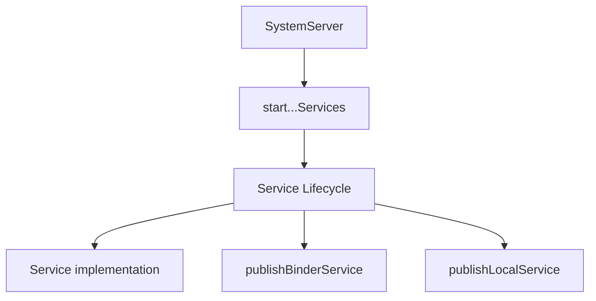
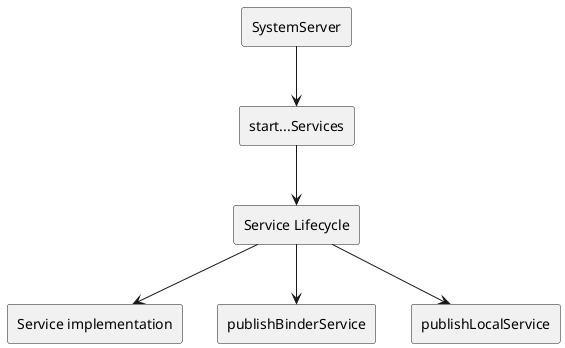
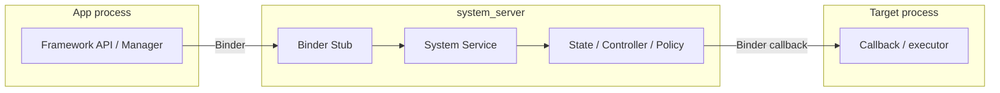
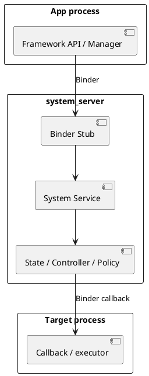
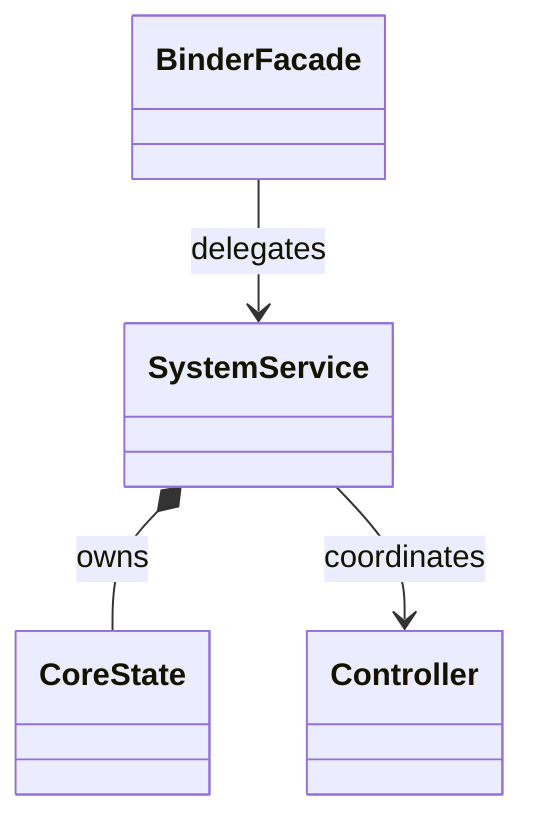
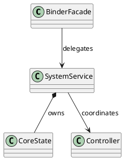
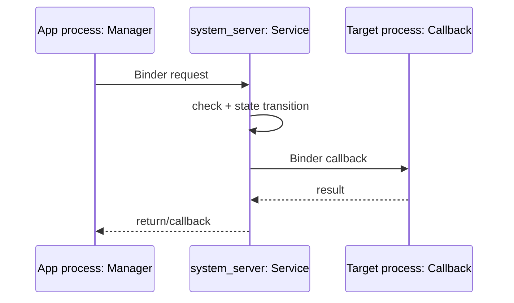
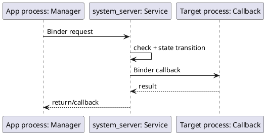

# System Service 源码深度分析报告模板

## 目录

1. 服务概览与分析基线
2. 源码入口与生命周期
3. 整体架构与核心组件
4. Binder/API 与状态模型
5. 关键业务调用链
6. 并发、安全与 Multi-user
7. 依赖、native 与调试
8. 设计总结与阅读路线

按服务特征裁剪模板。章节不适用时简短说明；不要虚构内容填满模板。

# `<ServiceName>` 源码深度分析

## 1. 服务概览与分析基线

### 1.1 概览

- 解决的问题：
- 所在进程：
- 服务边界：
- 核心职责：
- 本次深入范围：
- Further Deep Dive：

### 1.2 源码基线

- 仓库/模块：
- branch/tag/revision：
- Android 版本：
- 本地修改：
- 证据限制：

### 1.3 结论可信度

列出影响报告的关键推断和未验证项；已确认事实在正文紧邻源码位置标注。

## 2. 源码入口与生命周期

### 2.1 源码入口

| 类型 | 类/接口 | 文件 | 作用 |
|---|---|---|---|
| SystemServer entry | | | |
| Service/Lifecycle | | | |
| Framework Manager | | | |
| Binder AIDL/Stub | | | |
| Internal API | | | |
| Callback Binder | | | |

### 2.2 启动与发布

说明创建阶段、constructor、`onStart()`、publish 和 boot phase。

使用实际类/方法替换占位符；删除不存在的节点。

### 2.3 其它生命周期

- boot/systemReady：
- user：
- display：
- process/service death：
- cleanup：

## 3. 整体架构与核心组件

### 3.1 架构说明

解释公开 API、Binder server、内部组件、其它服务和目标进程的边界。

### 3.2 核心组件

| 类/文件 | 职责证据 | 创建者/持有者 | 生命周期 | 线程 | 锁 | 关键依赖 |
|---|---|---|---|---|---|---|
| | | | | | | |

### 3.3 核心组件关系

使用紧凑类图，只画核心 owner、state、controller、connection 和 Binder facade。

使用当前服务的真实类和关系替换占位内容；两种格式保持相同范围。

## 4. Binder/API 与状态模型

### 4.1 API/Binder 模型

- Manager/API：
- AIDL：
- Binder server：
- LocalServices/Internal API：
- callback/reverse Binder：

只列与所选核心流程相关的接口；用户要求完整 API 审计时再扩展。

### 4.2 关键 Binder 入口

| 入口 | 调用者/进程 | 权限与用户解析 | identity | 状态读写 | 外部调用/结果 |
|---|---|---|---|---|---|
| | | | | | |

### 4.3 核心状态

| 状态对象/字段 | owner | 维度 | 创建/清理 | readers/writers | 锁/线程 |
|---|---|---|---|---|---|
| | | | | | |

说明 global、per-user、per-display、per-window、per-process、per-UID 关系，并提供必要关系图。

## 5. 关键业务调用链

选择 2～4 条。每条使用以下结构。

### 5.n `<FlowName>`

- 业务目的：
- 入口/触发条件：
- 进程参与者：
- 完整调用链（含源码位置）：
- 线程与异步边界：
- identity 变化：
- 核心状态读写：
- callback/返回：
- 失败、死亡或清理路径：
- 推断/未验证项：

用当前源码的真实 participant 和同步/异步箭头替换模板。

## 6. 并发、安全与 Multi-user

### 6.1 线程与并发

| 线程/执行器 | 承担任务 | 切换入口 | 访问状态 | 与锁的关系 |
|---|---|---|---|---|
| | | | | |

### 6.2 锁模型

| 锁 | 保护状态 | 获取路径 | 外调/回调 | 顺序约束与风险证据 |
|---|---|---|---|---|
| | | | | |

### 6.3 权限与安全

| 入口/数据 | Permission/AppOps | UID/package | user | identity change | 拒绝方式 |
|---|---|---|---|---|---|
| | | | | | |

说明 SELinux/native 安全边界（如适用）。

### 6.4 Multi-user

说明 calling/current/target user、profile、跨 user 规则，以及服务属于 global+per-user、真正 per-user 或 hybrid 模型。

## 7. 依赖、native 与调试

### 7.1 Cross-service dependencies

| 依赖服务 | 访问机制 | 使用位置 | 在当前流程中的职责 |
|---|---|---|---|
| | | | |

提供只覆盖主要依赖的关系图。

### 7.2 Native/JNI/HAL

如适用，说明 Java/native/HAL 边界、接口、进程与停止深入的位置。

### 7.3 配置、Shell 与可观测性

| 接口/配置 | 读取/注册位置 | 作用域 | 动态更新 | 修改权限/可观察内容 |
|---|---|---|---|---|
| dumpsys | | | | |
| ShellCommand | | | | |
| Settings/DeviceConfig/property | | | | |

## 8. 设计总结与阅读路线

### 8.1 核心设计总结

- 核心设计思想与模式，以及为何使用：
- 最关键的数据结构和 owner：
- 最关键的调用链：
- 最容易误解的进程/身份/状态边界：
- 仍需验证的问题：

### 8.2 推荐源码阅读路线

| 顺序 | 文件/类 | 阅读目的 |
|---|---|---|
| 1 | SystemServer entry | 理解创建与启动阶段 |
| 2 | Service implementation | 建立 facade、状态和委托关系 |
| 3 | AIDL + Manager | 理解公开 API 与 Binder 边界 |
| 4 | Core state/controller/connection | 理解核心状态和业务链 |
| 5 | Policy/dependencies | 理解决策、安全与跨服务协作 |

替换为当前服务的实际文件，并说明每一步为何值得读。
